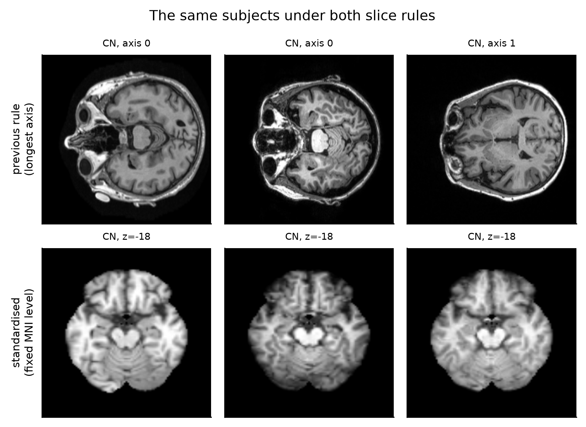

# Privacy-Preserving and Explainable Federated AI for Alzheimer's and Dementia Detection

[](https://github.com/Vaibhav2824/privacy-federated-alzheimer-detection/actions/workflows/ci.yml)
[](LICENSE)

Adit Srivastava, Aditya Raj, Vaibhav Gupta, Hardik Gupta, Agha Alfi Mirza
· PES University, Bangalore

**[Paper (PDF)](paper.pdf)** · **[Live site and demo](https://privacy-federated-alzheimer-detecti.vercel.app)** · **[Region-model API](https://ppxfl-api.onrender.com/model)**

CN / MCI / AD classification from ADNI structural MRI, trained without pooling
scans across sites and evaluated so that no subject — and, under the stricter
protocol, no *site* — appears in more than one split. The study measures three
things the literature usually reports separately: what federating over real
hospital sites costs, what subject-level differential privacy costs, and what
privacy does to a model's explanations.

The headline result is that the cost of subject-level privacy is set by the
**perturbed dimension**, not by the cohort or the mechanism. A 405-parameter
model over named anatomical regions stays usable at ε = 1, where the
23.5M-parameter network it replaces collapses onto the majority class.

> The numbers below, in the paper and on the site all come from the current
> **v6** features (deepmriprep segmentation; same subjects, folds and seeds as v5).

---

## Cohort and protocol

799 ADNI subjects (275 CN, 271 MCI, 253 AD) across 65 sites. Each scan is
oriented, skull-stripped and registered to MNI152 for quality control, then
segmented with [deepmriprep](https://pypi.org/project/deepmriprep/) (CAT12 in
PyTorch): a trained network separates grey matter, white matter and CSF, a
nonlinear warp aligns the brain to the CAT12 template, and the Neuromorphometrics
atlas is warped back so that each of 134 regions is measured on the subject's
own anatomy, as a volume over total intracranial volume. Every arm is measured
out-of-fold over five folds and three seeds, on the same subjects, so
comparisons between arms are comparisons of method rather than of sample.

Accuracy is from imaging features alone: the best of an ensemble, a tuned
ensemble and a tuned logistic regression, with hyperparameters chosen by nested
cross-validation inside each training fold. The last column appends age and sex.

| Task | Split | Accuracy | Macro F1 | Macro AUROC | + age & sex | Chance |
| --- | --- | --- | --- | --- | --- | --- |
| CN vs AD | subject-disjoint | **87.3%** | 0.872 | 0.919 | 88.8% | 52.1% |
| CN vs AD | site-disjoint | 86.7% | 0.866 | 0.923 | 87.2% | 52.1% |
| MCI vs AD | subject-disjoint | **69.3%** | 0.693 | 0.751 | 69.8% | 51.7% |
| MCI vs AD | site-disjoint | 69.3% | 0.693 | 0.749 | 68.7% | 51.7% |
| CN vs MCI | subject-disjoint | **67.5%** | 0.675 | 0.718 | 68.9% | 50.4% |
| CN vs MCI | site-disjoint | 68.9% | 0.688 | 0.725 | 68.9% | 50.4% |
| CN / MCI / AD | subject-disjoint | **58.6%** | 0.569 | 0.748 | 58.4% | 34.4% |
| CN / MCI / AD | site-disjoint | 57.9% | 0.566 | 0.747 | 58.1% | 34.4% |

The difficulty ordering across the four contrasts is the clinically expected
one, which is itself evidence that the pipeline measures anatomy rather than
acquisition. Three-class accuracy sits where blinded structural-MRI benchmarks
do: the best entry to the CADDementia challenge reached 63% on an unseen test set.

## Two measurement defects, and how they were corrected

This repository also carries the corrected re-evaluation of its own earlier
results, because both defects are ones a reader cannot see in a metric.

**Leakage.** An earlier version reported 97.0% federated accuracy by splitting
individual MRI *slices* rather than *subjects*, so scans of one patient sat on
both sides of the split. Rebuilt on subject-disjoint folds, that number fell to
36.1% against a 33.3% chance rate.

**The slice rule itself**, which is why the corrected number sat at chance.
The preprocessing chose its slice axis as the longest array axis:

```python
axial_axis = np.argmax(data.shape)   # the defect
```

Over this cohort that extracts a different anatomical plane per subject:

| stored shape | header orientation | axis chosen | plane actually extracted |
| --- | --- | --- | --- |
| (256, 240, 160) | RAS | 0 | **sagittal** |
| (256, 256, 166) | IPL | 0 | **axial** |
| (166, 256, 256) | RAS | 1 | **coronal** |

It raises no error, and chance-level accuracy is the correct result for that
input — no change of architecture, optimiser or cohort size would have moved
it. Three further problems compounded it: no spatial normalisation, no skull
stripping, and a file glob that counted five ADNI preprocessing levels of one
acquisition as five independent samples.



## Recovering orientation by measurement

Orientation could not simply be read back from the files: **272 of the 620
usable scans carry a degenerate identity affine** (`sform_code = 2`,
`qform_code = 0`), for which `nibabel` reports RAS and leaves a sagittally
acquired array untouched.

Each of the 48 axis permutations and reflections is therefore registered to a
4 mm **whole-head** ICBM152 target and scored. The target has to keep its
skull: matching an unstripped head against a skull-stripped brain scored
0.09–0.48 and selected a different, wrong orientation on the same subjects,
where head-to-head scores 0.68–0.79 with a clear margin to the third candidate.
That also fixes the pipeline order, since the stripping step leaves face and
neck behind when handed a scan lying on its side.

The fit is per (series family, array shape) group, since the convention belongs
to the DICOM-to-NIfTI conversion rather than to the subject:

| series group | scans | permutation | flips | handedness evidence |
| --- | --- | --- | --- | --- |
| MPRAGE 256×240×160 | 107 | (2,1,0) | (T,T,T) | four anchor subjects |
| MPRAGE 256×256×170 | 69 | (2,1,0) | (T,T,T) | determinant consistency |
| IR-SPGR 256×256×196 | 51 | (2,1,0) | (T,T,T) | determinant consistency |
| MPRAGE 256×240×176 | 38 | (2,1,0) | (T,T,T) | determinant consistency |
| MPRAGE 170×256×256 | 6 | (0,2,1) | (T,T,T) | determinant already agreed |
| MPRAGE 256×256×160 | 1 | (1,0,2) | (T,T,T) | determinant already agreed |

Registration cannot separate an orientation from its left–right mirror — the
two stay within about 0.01. Four subjects hold both a degenerate scan and one
with a usable header; registering a subject's two scans against each other uses
that subject's own asymmetry, and the fitted orientation beats its mirror on all
four (**0.87–0.93 against 0.61–0.70**). A per-subject quality score, the Pearson
correlation with the template inside the brain mask, is recorded so that
registration failures are excluded by a stated rule rather than by inspection.

## Federating over the real ADNI sites

The natural partition puts one client per real site, pooling sites below eight
subjects so that none is discarded, which yields 39 clients from 65 sites. The
heterogeneity is the cohort's own: one client holds no MCI and another no AD.

| Partition | CN / MCI / AD | CN vs AD |
| --- | --- | --- |
| IID | 53.9% | 84.6% |
| Dirichlet α = 0.5 | 53.1% | 83.7% |
| **Real ADNI sites** | **51.3%** | **82.1%** |

Against a tuned logistic regression trained centrally on the same subjects
(56.6% and 87.3%), federating over the real sites costs 5.3 and 5.2 points; the
simulated partitions cost 2.7–3.6. The real partition is the hardest of the
three, which indicates that the standard simulated benchmark does not capture
what makes multi-site federation difficult — extreme client-size imbalance and
genuine scanner variation sit on top of label skew.

A **site-disjoint** evaluation is reported next to the subject-disjoint one,
since a federated model is deployed at hospitals that did not contribute to it.
Across the four contrasts it moves accuracy by −0.7 to +1.3 points: at 65 sites,
holding a whole site out costs little.

## Subject-level differential privacy is a dimension problem

The Gaussian noise added to a summed update is isotropic in `d`, so its expected
norm is `σC√d`, while the update itself is bounded by `NC` and does not grow
with `d` at all. The usable regime is therefore fixed by the perturbed
dimension:

| model | d | noise/signal at ε=1 | ε=2 | ε=5 | ε=10 |
| --- | --- | --- | --- | --- | --- |
| Region model | 405 | **0.36** | **0.20** | **0.10** | **0.06** |
| ResNet50 head | 6,147 | 1.39 | 0.78 | 0.37 | 0.22 |
| ResNet50, full network | 23,508,035 | 86.05 | 48.11 | 23.10 | 13.86 |

Below 1.0 the update survives the noise, and utility follows:

| Task | ε | σ | Accuracy | Macro F1 | Attack AUROC |
| --- | --- | --- | --- | --- | --- |
| CN vs AD | non-private | — | 81.9% | 0.819 | — |
| CN vs AD | 10 | 1.83 | **86.2%** | 0.861 | — |
| CN vs AD | 5 | 3.04 | 85.5% | 0.854 | — |
| CN vs AD | 2 | 6.34 | 84.0% | 0.839 | — |
| CN vs AD | 1 | 11.34 | **80.7%** | 0.806 | — |
| CN / MCI / AD | non-private | — | 52.6% | 0.521 | 0.593 |
| CN / MCI / AD | 10 | 1.83 | 57.6% | 0.541 | 0.554 |
| CN / MCI / AD | 5 | 3.04 | 57.7% | 0.542 | 0.551 |
| CN / MCI / AD | 2 | 6.34 | 55.8% | 0.532 | 0.540 |
| CN / MCI / AD | 1 | 11.34 | 51.7% | 0.502 | **0.529** |

At this cohort size the noise acts as regularisation: every private
configuration at ε ≥ 2 beats its own non-private baseline, and the region model
stays usable down to ε = 1. A subject-level membership inference attack falls
from 0.593 to 0.529 against a chance rate of 0.500, so the formal budget and the
empirical attack move together.

## Explanations degrade faster than accuracy

Because every feature is a named atlas region, an attribution is a value per
region and two models' attributions are directly comparable — which slice-space
heat maps are not, since pixel (i, j) refers to different anatomy in different
subjects.

| ε | CN vs AD accuracy | Region-attribution agreement | Medial-temporal share |
| --- | --- | --- | --- |
| non-private | 81.9% | **0.860** | 10.8% |
| 10 | **86.2%** | **0.198** | 9.9% |
| 5 | 85.5% | 0.194 | 8.7% |
| 2 | 84.0% | 0.187 | 5.9% |
| 1 | 80.7% | 0.138 | 4.3% |

At ε = 10 the private model is *more* accurate than the non-private one while
the Spearman agreement of its region attribution has fallen by more than
three-quarters, from 0.860 to 0.198. A model that is simultaneously more
accurate and less explicable is exactly the case an accuracy-only
privacy–utility curve cannot show.

## What the cohort alone could explain

An imaging accuracy is evidence about imaging only if the cohort's demographics
could not have produced it unaided. Measured under exactly the protocol used for
the imaging models — same folds, same seeds, same metrics — on the 677 subjects
for whom the demographic export supplies both sex and age:

| Predictor | CN / MCI / AD | CN vs AD |
| --- | --- | --- |
| Sex only | 32.5% | 47.2% |
| Age only | 32.9% | 47.8% |
| Sex + age | 32.7% | 47.1% |
| Imaging (region volumes) | **56.2%** | **87.1%** |
| Imaging + demographics | 56.4% | 86.9% |
| Imaging, female only (*n* = 337) | 52.1% | 84.5% |
| Imaging, male only (*n* = 340) | 51.1% | 84.7% |

Chance is 33.4% and 50.0%. Imaging clearly exceeds what demographics buy, adding
demographics to the imaging features changes nothing, and the result survives
stratification, where sex is constant and can contribute nothing at all. The two
strata now come out level; the male-stratum advantage measured with the earlier
features did not survive better segmentation.

Rather than adjust for the imbalance, the cohort is also specified as a
**design**: subjects are selected so that every diagnosis-by-sex cell holds the
same number of subjects, drawn evenly across age bands. On that balanced cohort
of 630 subjects a sex-only rule scores exactly 33.3% by construction, and the
imaging model still reaches **57.8%** on three-class and **88.6%** on CN vs AD.
There is no confound left to adjust for.

## What better features changed

v5 and v6 use the same 799 subjects, folds and seeds; only the features differ.
v5 segmented affine-registered volumes with a three-class intensity mixture and
integrated over a fixed Harvard-Oxford atlas, which put the hippocampus label on
different anatomy in different subjects. v6 replaces that with deepmriprep.

| Measurement | v5 | v6 |
| --- | --- | --- |
| CN vs AD, centralised | 78.2% (AUROC 0.864) | **87.3%** (AUROC 0.919) |
| CN / MCI / AD, centralised | 51.9% | **58.6%** |
| CN vs AD, federated over real sites | 76.2% | **82.1%** |
| CN / MCI / AD, federated over real sites | 47.8% | **51.3%** |
| CN vs AD, subject-level DP at ε = 1 | 72.6% | **80.7%** |
| Attribution agreement at ε = 10 | 0.440 | 0.198 |

Every utility number rose, by 3.5 to 9.1 points, and the privacy and federation
findings kept their direction. Explanations became *more* sensitive to privacy
noise, not less, which strengthens the case for reporting them alongside accuracy.

## What the larger cohort changed

The study was first run on 297 subjects across 42 sites, then rerun unchanged on
2.6 times the subjects. Three-class accuracy moved from 51.1% to 52.5% and
CN vs AD from 79.7% to 78.9%, so the smaller cohort was neither systematically
optimistic nor pessimistic. Two findings did not survive, and both are reported
at their revised strength rather than at the one first measured:

- **Explanation collapse was overstated.** On 297 subjects, agreement at ε = 10
  measured 0.062 and the medial-temporal share roughly halved. On 760 the same
  measurements gave **0.437** and an essentially unchanged **12.4%**. The
  direction survives — agreement more than halves at a budget where accuracy
  rises — but the near-total collapse was substantially a small-sample artefact.
- **Site-disjoint does not beat subject-disjoint.** It does on the 638-subject
  demographic subset; it does not on the full 760. A reversal that appears on one
  subset and not on the whole is not evidence that site-disjoint evaluation is
  free, so the full-cohort ordering is the one reported.

## Live demo and API

The site's Demo page runs the paper's region model through a small API on
Render. It serves only the **subject-level DP-FedAvg model at ε = 10**, trained
on all 799 subjects with the same configuration as the privacy arm, so releasing
it carries a formal privacy guarantee for every training subject. Its
cross-validated three-class accuracy is the 57.6% reported above.

The API takes what [deepmriprep](https://pypi.org/project/deepmriprep/) writes
for one T1 scan, so the scan itself never leaves the user's machine:

```bash
pip install deepmriprep
python -c "from deepmriprep import run_preprocess; run_preprocess(input_paths=['t1.nii.gz'], output_dir='out', outputs=['neuromorphometrics_volumes', 'tiv'], dir_format='flat')"
```

`POST /predict` with `{"volumes_csv": "<the CSV text>", "tiv_cm3": <TIV>}`
returns CN/MCI/AD probabilities and the regions that drove the prediction;
`GET /model` returns the model card. Inputs are validated, requests are rate
limited per client, and only the Vercel site and localhost may call it from a
browser. The example on the Demo page is deepmriprep's output for the public
MNI152 template, so no ADNI-derived subject data is published.

## Repository layout

```
paper.tex, paper.pdf     the write-up; tables and prose numbers are generated
figures/v4/              figures for the 760-subject cohort
figures/v3/              figures for the first, 297-subject cohort
ui/                      seven-page site (Vercel, vercel.json); reads ui/public/data/site.json
backend/                 region-model API (FastAPI on Render, render.yaml); model.json is the ε = 10 DP model
ppxfl-alzheimer/
  src/preprocess_v3.py     scan selection, orientation, stripping, registration
  src/orientation*.py      the 48-candidate orientation search
  src/handedness.py        left/right resolution against anchor subjects
  src/vbm_features.py      deepmriprep region volumes (the current features)
  src/features.py          the earlier intensity-mixture Harvard-Oxford features
  src/slices_v3.py         2.5D slices at named MNI coordinates
  src/deep_features.py     frozen-backbone embeddings (head dimension 6,147)
  src/splits_v3.py         subject and site folds; natural/IID/Dirichlet clients
  src/federated_v3.py      FedAvg with subject-level DP and RDP accounting
  src/xai_v3.py            region attribution and its stability under privacy
  src/mia_v3.py            subject-level membership inference
  src/paper_tables*.py     results JSON to the paper's generated table blocks
  src/export_site.py       results JSON to the site's data file
  src/export_api_model.py  trains and exports the API's ε = 10 model
  src/paper_facts.py       results JSON to the paper's prose macros
  results_v6/              the current runs (deepmriprep features, 799 subjects)
  results_v4/              the 760-subject cohort's runs
  results_v3/              the first, 297-subject cohort's runs
  results_v2/              the slice-space runs, kept for the audit trail
  results/                 the earlier 32-subject cohort, kept for the audit
```

## Reproducing

ADNI scans are not redistributed, and no scan, derived array, trained weight or
subject-level table is committed here: access requires a
[data use agreement](https://adni.loni.usc.edu/data-samples/access-data/) with
ADNI directly.

```bash
pip install -e "ppxfl-alzheimer[dev]"
```

Fit the orientation of each series group against the ICBM152 target:

```bash
cd ppxfl-alzheimer && python -m src.fit_orientation --data-root ..
```

Run the full pipeline:

```bash
cd ppxfl-alzheimer && python run_v3.py
```

Stages are individually skippable, since registration and slice extraction are
cached on disk:

```bash
python run_v3.py --stages features centralised federated privacy aggregate figures
```

Build the current region-volume features with deepmriprep (resumable; about a
minute per scan on a laptop GPU), then evaluate them, rerun the federated and
private arms, and rebuild the site's data file:

```bash
python -m src.vbm_features
python -m src.evaluate_v3 --features data/mni2mm/features_vbm.npz --models ensemble ensemble_cv logreg_cv --out-dir results_v6/metrics_nocov
python -m src.experiments_v3 --features data/mni2mm/features_vbm.npz --out-dir results_v6/metrics federated
python -m src.experiments_v3 --features data/mni2mm/features_vbm.npz --out-dir results_v6/metrics privacy
python -m src.export_site
```

`--covariates` appends age and sex to the centralised models, and
`--adnimerge ADNIMERGE.csv` adds APOE4 and education. Diagnostic scores (MMSE,
CDR, ADAS, FAQ) are never used as inputs: ADNI assigns the diagnosis from them.

Rebuild the paper's generated tables and prose macros from the results, and
export the API model:

```bash
python -m src.paper_tables_v3 --summary results_v6/results_summary_v6.json --centralised-summary results_v6/results_summary_v6_imaging_only.json --law results_v6/metrics/dimension_law.json --confounds results_v6/metrics/confounds.json
python -m src.paper_facts
python -m src.export_api_model
```

Tests and the coverage gate:

```bash
pytest --cov --cov-config=.coveragerc
```

Structural checks on the paper source, and a check that every number it prints
still matches the recorded results:

```bash
python tools/texcheck.py && python src/check_paper_numbers.py
```

## Citing

```bibtex
@misc{srivastava2026ppxfl,
  title  = {Privacy-Preserving and Explainable Federated AI for
            Alzheimer's and Dementia Detection},
  author = {Srivastava, Adit and Raj, Aditya and Gupta, Vaibhav and
            Gupta, Hardik and Mirza, Agha Alfi},
  year   = {2026},
  note   = {PES University, Bangalore},
  url    = {https://github.com/Vaibhav2824/privacy-federated-alzheimer-detection}
}
```

Data used in the preparation of this work were obtained from the Alzheimer's
Disease Neuroimaging Initiative (ADNI) database. ADNI investigators contributed
to the design and implementation of ADNI and provided data, but did not
participate in the analysis or writing of this report.

## Disclaimer

Research code. Not a medical device, not validated for clinical use, and not to
be used to inform care for any person.

## License

MIT. See [LICENSE](LICENSE).
